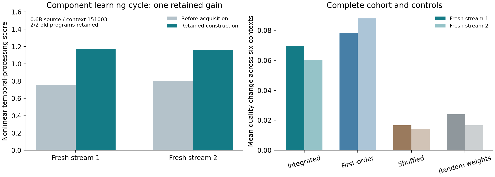

Shaping Gap Benchmark
=====================

Learning executable improvements from pretrained neural components
------------------------------------------------------------------

**The learning and compatibility cycle now operates without executing the
original transformer graph.** A component runtime acquires response interfaces,
uses them to connect frozen pretrained fragments, and learns which execution
change and shared compatibility interface to retain for fresh inputs.

**Latest: Checkpoint 05 - Component learning beyond the transformer graph.**
`Read Paper V <checkpoints/05-component-learning-cycle/paper/shaping-gap-benchmark-v.pdf>`_
· `Code, data and reproduction <checkpoints/05-component-learning-cycle/README.rst>`_
· `All results and controls <checkpoints/05-component-learning-cycle/results/FINDINGS.txt>`_

Measured advance
----------------

Twenty-four sampled neural fragments from each source context execute through
a new recurrent runtime. Acquired response/partial interfaces guide which
fragments interact. Transformer blocks, attention, tokenization and generation
are outside its execution path. The selected pretrained component arrays stay
fixed; the acquired runtime and interfaces are additional recorded state.

In one 0.6B-derived context, fresh nonlinear temporal-processing scores improve
**0.75648 -> 1.17401** and **0.79913 -> 1.16017**, with **2/2** eligible old
programs retained through the shared interface, versus **1/2** direct.
Across all six integrated-guidance contexts, one retained update and five
baseline fallbacks give positive mean score changes **+0.06959/+0.06017** and
**18/18** old program instances retained.

All 24 model/context/control conditions are released. First-order guidance has
two strict successes; shuffled and norm-matched random-weight controls have one
each. This establishes one finite component-level learning/reuse cycle, with
the controls, precision differences and resource costs explicit.

**Verification:** 1,440 score vectors, all choices and 360 seals replay;
4,800 component fields and 9,600 stage-binding choices are independently checked.
CPU replay and execution use the supplied component banks, without loading the
original language models. The checkpoint guide separates compiled-runtime memory
from full-model preparation and documents numerical materialization tolerances.

Checkpoint 04 remains the whole-body foundation
-----------------------------------------------

`Paper IV <checkpoints/04-experience-acquired-reuse/paper/shaping-gap-benchmark-iv.pdf>`_
closed the experience/selection/reuse cycle around the complete frozen transformer
body: two contexts gained approximately 4-5% on both fresh streams while retaining
13/13 and 18/18 old programs. Checkpoint 05 brings that cycle into component
execution. Each study retains its own metric values, complete cases and scope.

Start with the current result
-----------------------------

From the repository root::

    python3 -m pip install -r checkpoints/05-component-learning-cycle/requirements-analysis.txt
    python3 checkpoints/05-component-learning-cycle/code/replay.py
    python3 checkpoints/05-component-learning-cycle/code/report.py

Replay loads no source language model. The `checkpoint guide <checkpoints/05-component-learning-cycle/README.rst>`_
also documents full component-cycle acquisition and optional original-checkpoint
extraction verification. New outputs go under the checkpoint's ``runs/`` directory.

Research checkpoints
--------------------

Each checkpoint is an advancement with its own paper, code, protocols, evidence
and publication commit. Earlier papers and evidence retain their original paths.
Follow the `commit history <https://github.com/calysteon/shaping-gap-benchmark/commits/main/>`_
and `machine-readable index <CHECKPOINTS.json>`_ to track the buildup.

.. list-table:: Published research checkpoints
   :header-rows: 1
   :widths: 10 40 30 20

   * - Checkpoint
     - Advance
     - Paper and evidence
     - Publication record
   * - **05 · Central result**
     - Learned component execution completes an acquired execution/interface reuse
       cycle without the original transformer graph; full controls and costs.
     - `Paper V <checkpoints/05-component-learning-cycle/paper/shaping-gap-benchmark-v.pdf>`_
       · `Code, data and reproduction <checkpoints/05-component-learning-cycle/README.rst>`_
     - November 13, 2026 · `Checkpoint commits <https://github.com/calysteon/shaping-gap-benchmark/commits/main/checkpoints/05-component-learning-cycle>`_
   * - **04 · Experience and reuse**
     - Experience acquires a retained execution/interface pair; two fresh-stream
       joint successes, positive pooled quality and 140/141 old instances retained.
     - `Paper IV <checkpoints/04-experience-acquired-reuse/paper/shaping-gap-benchmark-iv.pdf>`_
       · `Code, data and reproduction <checkpoints/04-experience-acquired-reuse/README.rst>`_
     - November 13, 2026 · `Checkpoint commits <https://github.com/calysteon/shaping-gap-benchmark/commits/main/checkpoints/04-experience-acquired-reuse>`_
   * - **03 · Execution and compatibility**
     - Preserved neural augmentation and shared observation interfaces establish
       the execution/compatibility mechanism over two frozen model sizes.
     - `Paper III <checkpoints/03-preserved-neural-augmentation/paper/shaping-gap-benchmark-iii.pdf>`_
       · `Code, data and reproduction <checkpoints/03-preserved-neural-augmentation/README.rst>`_
     - November 13, 2026 · `17822c9 <https://github.com/calysteon/shaping-gap-benchmark/commit/17822c9fab3291c91fe476d0a04bf869c0244e15>`_
   * - **02 · Scaling and functions**
     - Response-moment evaluation scales from 22 to 512 components;
       fixed programs implement complete finite Boolean functions.
     - `Paper II <checkpoints/02-scaling-and-functions/paper/shaping-gap-benchmark-ii.pdf>`_
       · `Code, data and reproduction <checkpoints/02-scaling-and-functions/README.rst>`_
     - November 12, 2026 · `f558ee9 <https://github.com/calysteon/shaping-gap-benchmark/commit/f558ee9f3cda6c2fdc734d9d5ecd8ee3b6cd63d9>`_
   * - **01 · Foundation**
     - Effect interfaces, incoming-context sensitivity and compatibility-guided
       execution of original frozen neural components.
     - `Paper I <paper/shaping-gap-benchmark.pdf>`_
       · `Original artifact guide <checkpoints/01-effect-interfaces/README.rst>`_
     - November 12, 2026 · `20b5a2a <https://github.com/calysteon/shaping-gap-benchmark/commit/20b5a2a8d63998b13e78041d0d3b7ec7812779e7>`_

The next research threshold
---------------------------

Start from the accepted component runtime and acquire a second retained gain,
composing compatibility interfaces into one fixed-size map while charging
reorganization, failed trials and maintenance. This tests cumulative development
from the demonstrated learning-and-reuse cycle. Stronger regression control and
transfer to unseen runtimes remain explicit parts of the research program.

Authors and citation
--------------------

Nathaniel Oh and Paul Attie. Cite the paper associated with the checkpoint used.
`CITATION.cff <CITATION.cff>`_ points to the current paper. Papers are publicly
available here; arXiv identifiers will be added when assigned. Model provenance
and licensing are in `THIRD_PARTY_NOTICES.rst <THIRD_PARTY_NOTICES.rst>`_.
Weights are downloaded separately.
