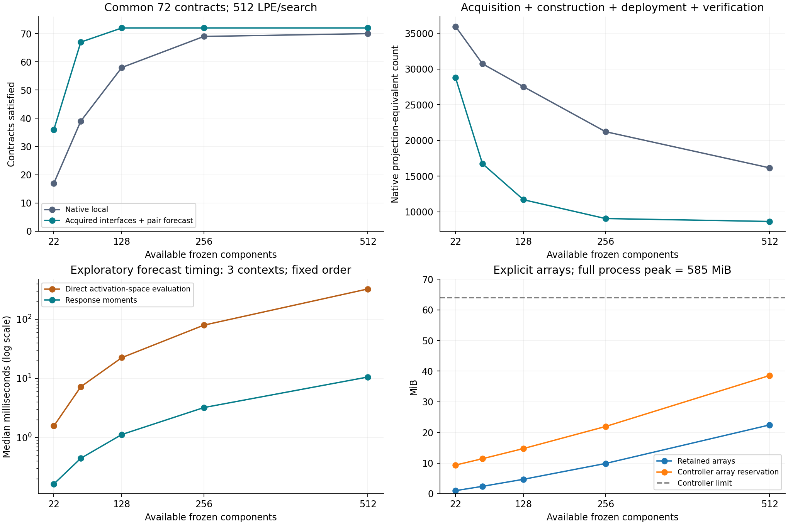

Shaping Gap Benchmark
====================

An evolving research benchmark for constructing executable computations from
acquired interfaces to ordinary frozen pretrained components.

**Latest: Checkpoint 02 — Scalable evaluation and verified functional construction.**
`Read Paper II <checkpoints/02-scaling-and-functions/paper/shaping-gap-benchmark-ii.pdf>`_
or `reproduce the results <checkpoints/02-scaling-and-functions/README.rst>`_.

Research checkpoints
--------------------

Each research checkpoint is introduced in one publication commit and includes
its own paper, code, protocols, evidence and measured contribution. Earlier
papers and evidence retain their original paths. Follow the
`checkpoint history <https://github.com/calysteon/shaping-gap-benchmark/commits/main/>`_
to track advances. The machine-readable index is `CHECKPOINTS.json <CHECKPOINTS.json>`_.

.. list-table:: Published research checkpoints
   :header-rows: 1
   :widths: 10 40 30 20

   * - Checkpoint
     - Advance
     - Paper and evidence
     - Publication record
   * - **02 · Latest**
     - Response-moment evaluation scales the repertoire from 22 to 512 components;
       fixed programs implement complete finite Boolean functions.
     - `Paper II <checkpoints/02-scaling-and-functions/paper/shaping-gap-benchmark-ii.pdf>`_
       · `Code, data and reproduction <checkpoints/02-scaling-and-functions/README.rst>`_
     - November 12, 2026 · `Checkpoint commits <https://github.com/calysteon/shaping-gap-benchmark/commits/main/checkpoints/02-scaling-and-functions>`_
   * - **01 · Foundation**
     - Effect interfaces, incoming-context sensitivity and compatibility-guided
       execution of original frozen neural components.
     - `Paper I <paper/shaping-gap-benchmark.pdf>`_
       · `Original artifact guide <checkpoints/01-effect-interfaces/README.rst>`_
     - November 12, 2026 · `20b5a2a <https://github.com/calysteon/shaping-gap-benchmark/commit/20b5a2a8d63998b13e78041d0d3b7ec7812779e7>`_

What checkpoint 02 establishes
------------------------------

* **Larger-bank construction:** at 128 components, acquired paired guidance
  satisfies 72/72 common numerical contracts versus 58/72 for native-local
  guidance, with 57.50% less charged native projection-equivalent work.
* **Functional construction:** one fixed program per function/encoding implements
  all truth-table inputs on 24/24 targets. Paired guidance meets the stricter
  output margin on 23/24 versus 22/24 for one-step guidance, using 26.00% less
  charged native work, while taking more search time.
* **Execution fidelity:** all 768 selected programs independently replay through
  original native components bit exactly. NumPy-only acquired-bank replay also
  preserves all recorded contract/function decisions without loading the model.

Charged work includes source acquisition, attempted construction, deployment
and independent selected-program verification. LPE is a native-query proxy;
scalar planning, storage, process memory and research diagnostics are reported
separately. The 64 MiB envelope covers explicit controller arrays. It does not
include the loaded model. The functions have two or three inputs, with the full
finite specification available during construction. The architectural form and
numeric input/output convention are supplied.

Start with the latest checkpoint
--------------------------------

From the repository root, in an environment with NumPy and Matplotlib::

    python3 -m pip install -r requirements-analysis.txt
    python3 checkpoints/02-scaling-and-functions/code/replay.py
    python3 checkpoints/02-scaling-and-functions/code/report.py

These commands load no model and write new outputs under the checkpoint's
``runs/`` directory. Full native verification and experiment reproduction are
documented in the `checkpoint guide <checkpoints/02-scaling-and-functions/README.rst>`_.
The original first-paper commands remain available in its
`archived guide <checkpoints/01-effect-interfaces/README.rst>`_.

Research direction
------------------

The foundation is a runtime that acquires descriptions, uses them to construct
temporary native programs and checks their actual execution. The current
checkpoint makes larger repertoires usable and connects this mechanism to
externally specified functions. The next question is whether acquired interfaces
to successful constructed programs reduce later capability-acquisition cost,
with regression control, retention and maintenance charged.

Authors and citation
--------------------

Nathaniel Oh and Paul Attie. Cite the paper associated with the checkpoint used.
Each checkpoint has a citation record; `CITATION.cff <CITATION.cff>`_ indexes the
current paper. The papers are publicly available here; arXiv identifiers will be
added when assigned.

Model provenance and third-party terms are documented in
`THIRD_PARTY_NOTICES.rst <THIRD_PARTY_NOTICES.rst>`_. The model checkpoint is
downloaded separately.
