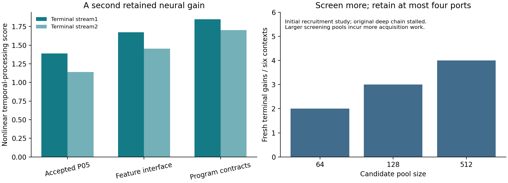

Shaping Gap Benchmark
=====================

Learning executable improvements from pretrained neural components
------------------------------------------------------------------

**A runtime built from frozen pretrained components has acquired a second
compatible neural improvement.** It recruits an additional native component,
learns one shared interface to keep earlier programs usable, and selects the
execution/interface pair from experience before testing on fresh inputs.

**Latest: Checkpoint 06 - A second compatible neural acquisition.**
`Read Paper VI <checkpoints/06-cumulative-contract-interfaces/paper/shaping-gap-benchmark-vi.pdf>`_
· `Code, data and reproduction <checkpoints/06-cumulative-contract-interfaces/README.rst>`_
· `All findings <checkpoints/06-cumulative-contract-interfaces/results/FINDINGS.txt>`_

Measured advance
----------------

From the already improved Checkpoint 05 runtime, two untouched terminal
nonlinear temporal-processing scores rise **1.38792 -> 1.84921** and
**1.13904 -> 1.70404** (33.24%/49.60%), while **6/6** protected program instances
remain usable. These instances belong to three frozen program libraries;
they are not six distinct new functions. The feature-interface control gains
20.52%/27.61%; the interface-only control retains baseline.

The successful construction adds **one original pretrained component** and
keeps **one 600-value shared map**, with 1,102,272 bytes of conservatively counted
runtime/program arrays. The source weights remain fixed and the original
transformer graph is outside execution. The acquired map uses numerical source
targets through unchanged programs. One additional acquisition is confirmed;
the stronger two-additional-gain criterion is not met.

Recruitment and application evidence
------------------------------------

The initial recruitment study screens **64/128/512** candidates in fixed chunks,
yielding **2/3/4** terminal gains across six inherited contexts. Random-128 and
resident controls each yield three. Larger pools cost more to screen, and the
already improved chain stalls in this first study. That measured preservation
bottleneck motivates the prospectively tested program-contract interface.

A separate chronological appliance-energy transfer test keeps the acquired
controllers fixed. One-hour forecast RMSE falls **83.1373 -> 82.6682 Wh** (0.564%),
but ten-minute error rises 2.220%, and a 64-lag ridge autoregression reference is
stronger at all horizons. The application primary criterion is not met. All
results, controls, failed attempts and lifecycle costs are released. The next
acquisition can now target those concrete forecast requirements directly.

**Verification:** 12,112 temporal score vectors, 1,109 seals, 300 program-map
stationarity checks, 8,320 full-coordinate native response points and 48
application metric rows replay. Fresh portable contract acquisition and
application execution reproduce the reported outcomes exactly.

Checkpoint 04 remains the whole-body foundation
-----------------------------------------------

`Paper IV <checkpoints/04-experience-acquired-reuse/paper/shaping-gap-benchmark-iv.pdf>`_
closed the experience/selection/reuse cycle around the complete frozen transformer
body: two contexts gained approximately 4-5% on both fresh streams while retaining
13/13 and 18/18 old programs. Checkpoint 05 brings that cycle into component
execution. Each study retains its own metric values, complete cases and scope.

Start with the current result
-----------------------------

From the repository root::

    python3 -m pip install -r checkpoints/06-cumulative-contract-interfaces/requirements-analysis.txt
    python3 checkpoints/06-cumulative-contract-interfaces/code/replay.py

Replay uses supplied component banks on CPU. The `checkpoint guide <checkpoints/06-cumulative-contract-interfaces/README.rst>`_
also documents fresh acquisition, real-data forecasting and optional exact-revision
source-model re-extraction. Outputs go under the checkpoint's ``runs/`` directory.

Research checkpoints
--------------------

Each checkpoint is an advancement with its own paper, code, protocols, evidence
and publication commit. Earlier papers and evidence retain their original paths.
Follow the `commit history <https://github.com/calysteon/shaping-gap-benchmark/commits/main/>`_
and `machine-readable index <CHECKPOINTS.json>`_ to track the buildup.

.. list-table:: Published research checkpoints
   :header-rows: 1
   :widths: 10 40 30 20

   * - Checkpoint
     - Advance
     - Paper and evidence
     - Publication record
   * - **06 · Central result**
     - A second retained neural gain with shared program-contract compatibility;
       bounded recruitment, complete controls and a real application boundary.
     - `Paper VI <checkpoints/06-cumulative-contract-interfaces/paper/shaping-gap-benchmark-vi.pdf>`_
       · `Code, data and reproduction <checkpoints/06-cumulative-contract-interfaces/README.rst>`_
     - November 13, 2026 · `Checkpoint commits <https://github.com/calysteon/shaping-gap-benchmark/commits/main/checkpoints/06-cumulative-contract-interfaces>`_
   * - **05 · Component learning**
     - Learned component execution completes an acquired execution/interface reuse
       cycle without the original transformer graph; full controls and costs.
     - `Paper V <checkpoints/05-component-learning-cycle/paper/shaping-gap-benchmark-v.pdf>`_
       · `Code, data and reproduction <checkpoints/05-component-learning-cycle/README.rst>`_
     - November 13, 2026 · `Checkpoint commits <https://github.com/calysteon/shaping-gap-benchmark/commits/main/checkpoints/05-component-learning-cycle>`_
   * - **04 · Experience and reuse**
     - Experience acquires a retained execution/interface pair; two fresh-stream
       joint successes, positive pooled quality and 140/141 old instances retained.
     - `Paper IV <checkpoints/04-experience-acquired-reuse/paper/shaping-gap-benchmark-iv.pdf>`_
       · `Code, data and reproduction <checkpoints/04-experience-acquired-reuse/README.rst>`_
     - November 13, 2026 · `Checkpoint commits <https://github.com/calysteon/shaping-gap-benchmark/commits/main/checkpoints/04-experience-acquired-reuse>`_
   * - **03 · Execution and compatibility**
     - Preserved neural augmentation and shared observation interfaces establish
       the execution/compatibility mechanism over two frozen model sizes.
     - `Paper III <checkpoints/03-preserved-neural-augmentation/paper/shaping-gap-benchmark-iii.pdf>`_
       · `Code, data and reproduction <checkpoints/03-preserved-neural-augmentation/README.rst>`_
     - November 13, 2026 · `17822c9 <https://github.com/calysteon/shaping-gap-benchmark/commit/17822c9fab3291c91fe476d0a04bf869c0244e15>`_
   * - **02 · Scaling and functions**
     - Response-moment evaluation scales from 22 to 512 components;
       fixed programs implement complete finite Boolean functions.
     - `Paper II <checkpoints/02-scaling-and-functions/paper/shaping-gap-benchmark-ii.pdf>`_
       · `Code, data and reproduction <checkpoints/02-scaling-and-functions/README.rst>`_
     - November 12, 2026 · `f558ee9 <https://github.com/calysteon/shaping-gap-benchmark/commit/f558ee9f3cda6c2fdc734d9d5ecd8ee3b6cd63d9>`_
   * - **01 · Foundation**
     - Effect interfaces, incoming-context sensitivity and compatibility-guided
       execution of original frozen neural components.
     - `Paper I <paper/shaping-gap-benchmark.pdf>`_
       · `Original artifact guide <checkpoints/01-effect-interfaces/README.rst>`_
     - November 12, 2026 · `20b5a2a <https://github.com/calysteon/shaping-gap-benchmark/commit/20b5a2a8d63998b13e78041d0d3b7ec7812779e7>`_

The next research threshold
---------------------------

Acquire directly against application contracts: improve longer-horizon forecasts
while preserving the short-horizon consumer and competing with AR64. Continue
beyond this second neural gain, then test replacement in a full active bank.
Discovery, failed proposals, verification and maintenance stay in the cost
ledger. Application quality and lifetime economics define the next threshold.

Authors and citation
--------------------

Nathaniel Oh and Paul Attie. Cite the paper associated with the checkpoint used.
`CITATION.cff <CITATION.cff>`_ points to the current paper. Papers are publicly
available here; arXiv identifiers will be added when assigned. Model provenance
and licensing are in `THIRD_PARTY_NOTICES.rst <THIRD_PARTY_NOTICES.rst>`_.
Weights are downloaded separately.
