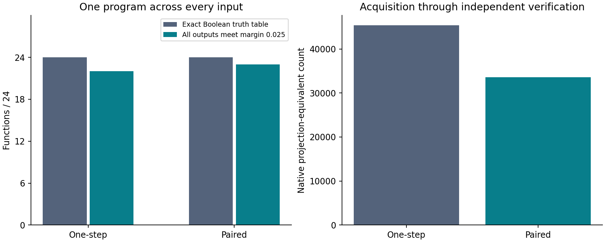

Checkpoint 02: Scalable evaluation and verified functional construction
======================================================================

Nathaniel Oh and Paul Attie · November 12, 2026

`Shaping Gap Benchmark II: Scalable Effect-Interface Evaluation and Verified
Functional Construction <paper/shaping-gap-benchmark-ii.pdf>`_

This checkpoint extends the effect-interface runtime established in
`Paper I <../../paper/shaping-gap-benchmark.pdf>`_. It derives a response-moment
evaluator, measures construction across 22/64/128/256/512 original frozen
components, and constructs fixed programs implementing independently specified
Boolean functions over every input.

Recorded advance
----------------

.. list-table:: Scaling study: common 72 numerical contracts
   :header-rows: 1

   * - Components
     - Native-local solved
     - Acquired paired solved
     - Native-local charged LPE
     - Acquired paired charged LPE
   * - 22
     - 17
     - 36
     - 35,946
     - 28,767
   * - 64
     - 39
     - 67
     - 30,719
     - 16,735
   * - 128
     - 58
     - 72
     - 27,510
     - 11,691
   * - 256
     - 69
     - 72
     - 21,216
     - 9,055
   * - 512
     - 70
     - 72
     - 16,154
     - 8,649

At 128 components, paired guidance satisfies 14 additional contracts with
57.50% less charged native work. At 512 components, its explicit controller-array
reservation is 40,435,712 bytes within 64 MiB; process peak including the model
is 613,302,272 bytes. Measured algorithm components at 512 are slower for paired
guidance despite fewer native queries. See the complete time/resource ledger.

.. list-table:: Function study: eight functions across three encodings
   :header-rows: 1

   * - Outcome
     - One-step acquired guidance
     - Paired acquired guidance
   * - Exact complete truth tables
     - 24/24
     - 24/24
   * - Every output meets margin 0.025
     - 22/24
     - 23/24
   * - Charged native LPE
     - 45,353
     - 33,561
   * - Aggregate search wall (seconds)
     - 7.31
     - 11.94

The same selected graph runs on every input for a target. Paired guidance uses
26.00% less charged native work at matched exact Boolean quality, with more
search time. The functions are two/three-input AND, OR and XOR, plus three-input
majority and multiplexer. Every finite input is available during construction;
this is synthesis, not held-out-input learning. The supplied encoder/decoder is
independent of the target function. The architectural law is supplied and its
coefficients are acquired. No random-weight substrate control is included.

Cost scope and evidence
-----------------------

Charged LPE includes historical inventory discovery, inherited setup, source
acquisition, every attempted native branch/input, initial readouts, one deployment
and independent selected-program verification. Native primitive vectors, extra
research diagnostics, scalar planning, memory and complete wall measurements are
separate fields in `results/cost-ledger.json <results/cost-ledger.json>`_. LPE is
not FLOPs or energy. Retained arrays do not change, so these studies have zero
maintenance events and do not evaluate continual library growth.

All 720 scaling programs and 48 function programs independently replay bit
exactly through original native components. The scaling verification additionally
checks 512 sampled branches. Function verification reconstructs all Boolean
specifications and checks all 312 input executions and intermediate resource
limits. Model/source hashes remain unchanged.

Reproduce without a model
-------------------------

From the repository root::

    python3 -m pip install -r requirements-analysis.txt
    python3 checkpoints/02-scaling-and-functions/code/replay.py
    python3 checkpoints/02-scaling-and-functions/code/report.py

The NumPy-only replay checks all 768 selected programs using the acquired bank.
Expected agreement is 768/768 for recorded numerical/function-margin decisions,
with all Boolean decisions preserved. Maximum readout error is approximately
3.21e-5. Native float32 execution remains authoritative. The report reconstructs
all summary tables, cost vectors and plots from the recorded data.

New outputs go under ``checkpoints/02-scaling-and-functions/runs/``. The supplied
``data/`` and ``results/`` evidence is not overwritten.

Native verification and construction
------------------------------------

Native execution requires Apple Silicon/Metal and ``requirements-native.txt``.
Use ``Qwen/Qwen3-0.6B-MLX-4bit`` revision
``173234aa840d113125e9f2271100ddbaf16c9620``. The parameter digest is in
``data/inherited/checkpoint.json``; model weights are not bundled. From the root::

    python3 checkpoints/02-scaling-and-functions/code/verify_scaling.py --checkpoint /path/to/model
    python3 checkpoints/02-scaling-and-functions/code/verify_functions.py --checkpoint /path/to/model

These commands check the recorded programs and compressed complete branch traces
and write new verification receipts under ``runs/``. To rerun acquisition and
construction::

    python3 checkpoints/02-scaling-and-functions/code/run_scaling.py --checkpoint /path/to/model
    python3 checkpoints/02-scaling-and-functions/code/run_functions.py --checkpoint /path/to/model

The function driver defaults to the sealed source in ``data/scaling``. To use
the newly acquired source instead, add
``--source checkpoints/02-scaling-and-functions/runs/scaling``. Native drivers
refuse to overwrite an existing output directory; choose ``--output`` for a new
replication. No hosted API, natural-language prompt, tokenizer, original model
forward or pretrained-weight update is used.

Artifact map
------------

* `paper/ <paper/>`_: paper PDF and complete TeX/figure/table source.
* `code/ <code/>`_: evaluator, native construction, independent verification,
  model-free replay and deterministic result analysis.
* `protocols/ <protocols/>`_: prospective scaling and function protocols.
* `data/scaling/ <data/scaling/>`_: sealed bank, cases, selected programs,
  complete ``runs.jsonl.gz`` trace, source diagnostics and verification receipt.
* `data/functions/ <data/functions/>`_: complete function specifications, inputs,
  selected programs, compressed trace and verification receipt.
* `data/inherited/ <data/inherited/>`_: inherited public domain setup and provenance.
* `data/provenance.json <data/provenance.json>`_: original/public file hashes and
  documented path/format transformations. Executed runner/helper snapshots are
  preserved under each data directory; the public entry points add portable paths.
* `results/ <results/>`_: compact tables, plots and transparent cost scopes.
* `theory/response-moments.txt <theory/response-moments.txt>`_: algebra and bounds.
* `VERIFICATION.json <VERIFICATION.json>`_: publication-package checks.

Build the paper with Tectonic from ``paper/source``::

    tectonic main.tex

The PDF is a separate follow-on paper. The first paper, its code and its evidence
remain at their original repository paths. The
`checkpoint index <../../CHECKPOINTS.json>`_ links both publication records.
