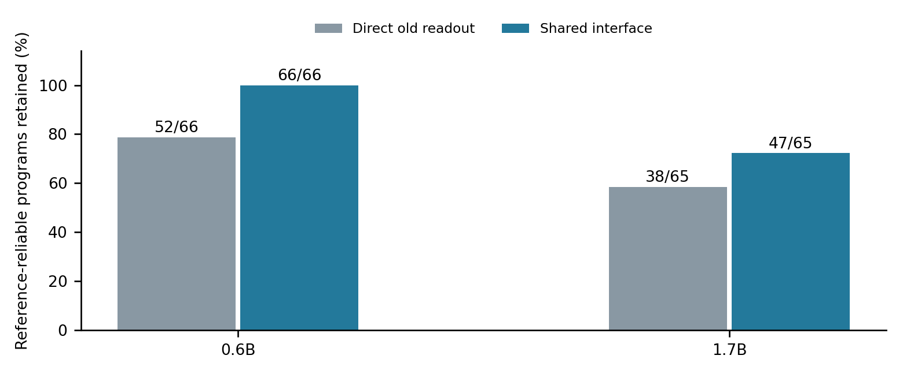

Checkpoint 03: Preserved neural augmentation and reusable observation interfaces
===============================================================================

**Paper III — Nathaniel Oh and Paul Attie — November 13, 2026**

`Read the paper <paper/shaping-gap-benchmark-iii.pdf>`_ ·
`LaTeX source <paper/source/main.tex>`_ ·
`All-case results <results/report/RESULTS.txt>`_ ·
`Cost ledger <results/cost-ledger.json>`_ ·
`Checkpoint history <../../CHECKPOINTS.json>`_

Question and measured advance
-----------------------------

Can an acquired execution update be accompanied by an acquired interface that
keeps existing computation usable? We augment a functioning recurrent runtime
over a frozen pretrained transformer, then fit one shared observation interface
for its unchanged existing readouts.

* **Reusable compatibility:** shared transport retains 113/131 fresh-reference-
  reliable program instances, versus 90/131 with direct reuse. It recovers 23
  instances; 11/12 charts retain every reference-reliable program.
* **Repeated processing-quality gains:** two primary updates improve the finite
  nonlinear temporal score in all three blocks while retaining their old
  programs. One 1.7B chart also exceeds both matched controls in every block.
* **Full case accounting:** the mean primary quality effect is negative. All
  twelve charts, four signed doses, matched controls and adverse outcomes are
  retained. This result makes context-sensitive update selection the next
  research question.
* **Execution integrity:** independent original-checkpoint execution reproduces
  4,032 saved native outputs bit exactly; model parameter digests remain fixed.

Mechanism and scope
-------------------

Two continuous positions traverse all 28 blocks of a Qwen3 transformer body.
Eight recurrent state variables are returned through an external matrix. A
source-calibrated rank-one addition is merged into that same matrix shape.
The body receives numerical states directly; there is no English prompt,
tokenizer call or language-generation head in this experiment.

A 40-by-40 affine compatibility map is fitted to paired neural trajectories
without functional target labels. One map per runtime change serves all 143
unchanged readouts. Readout construction itself uses supervised Legendre target
values during the earlier assessment training block. The new-runtime score sums
positive held-out R-squared over 109 nonlinear multi-lag functionals; it measures
processing quality on this finite suite. No primary new target crosses the
strict reliability threshold in all three blocks.

The 131-instance retention denominator requires the unchanged baseline to stay
reliable in all three blocks. Before fresh validation there were 134 reliable
instances; three also fail under the fresh unchanged baseline. Direct/shared
numerators remain 90/113 under the unfiltered denominator. A post hoc all-three-
block retention test gives 110/131 and complete retention in 9/12 charts.
Normalization-only and learned diagonal controls retain 80/131 and 83/131.

Reproduce without downloading models
------------------------------------

From this checkpoint directory::

    python3 -m pip install -r requirements-analysis.txt
    python3 code/replay.py
    python3 code/report.py

Replay independently reconstructs targets, frozen predictions, source action
calibration, transport fits, 76 seals and the publication manifest. Report
rebuilds case tables and figures. New outputs go under ``runs/``. The recorded
``data/`` and ``results/`` remain immutable. The publication includes complete
trajectory records; the largest file is below GitHub's 100 MiB file limit.

Native reproduction
-------------------

The recorded environment is Apple M4 Max, 36 GiB, NumPy 2.5.4,
MLX 0.32.4 and MLX-LM 0.32.2. Native MLX execution requires supported Apple
hardware. Analysis replay is NumPy-only; figure generation uses Matplotlib.

In a suitable environment, from this checkpoint directory::

    python3 -m pip install -r requirements-native.txt
    python3 code/prepare_native.py --models /path/to/model-cache
    python3 runs/native-workspace/preserved-return-study/run.py
    python3 runs/native-workspace/observer-transport-study/run.py
    python3 code/replay.py --data-root runs/native-workspace

The preparation command downloads pinned model revisions if absent. To use
existing copies, pass ``--checkpoint-06 PATH --checkpoint-17 PATH``. Downloading
models requires network access; model weights are not committed. Model revisions
and loaded-array digests are recorded in the receipts. Software/hardware changes
may affect exact bit equality; record tolerances when re-executing elsewhere.

Preparation copies the supplied inherited P55/P56 fixtures and current runners
into a separate workspace, updating only local model receipt paths there. This
reproduces the new cycle from its declared acquired starting state. The inherited
source studies' snapshots, protocols, manifests, helpers and minimal required
arrays are retained under ``data/results/`` as provenance. Reacquiring those
fixtures is a separate source study; its recorded 834,732 native sequences are
charged in the ledger rather than hidden as free acquisition.

The current runners write all assessment records before summarization. Independent
native verification is available as ``preserved-return-study/verify_native.py``
in the prepared workspace; use its recorded source and model paths. The published
native-verification receipt records the already completed verification run.

Costs and retained state
------------------------

Incremental source, assessment, fresh validation and independent native checks
use 1,413,312 two-position native sequences, including controls and padding.
The deployed return remains 8-by-(2 hidden width); recurrent state remains eight
values. Compatibility adds 1,600 float64 coefficients (12,800 bytes), 160
normalization values (1,280 bytes), and affine observation work. Whole-process
peak memory and experimental trace storage are separately recorded. Pretraining
is inherited; energy was not measured.

Artifact map
------------

* ``paper/``: Paper III PDF and complete LaTeX/figure/table source.
* ``code/``: portable replay/report entrypoints and captured study implementations.
* ``protocols/``: recorded design and prospective supplemental retention analysis.
* ``data/results/``: numeric records, frozen programs, receipts and inherited fixtures.
* ``results/``: all-condition analysis, costs, independent verification and figures.
* ``MANIFEST.json`` and ``VERIFICATION.json``: publication integrity and validation.
* ``data/provenance.json``: portable-path redactions in model receipt metadata.

Next question
-------------

Can a learned context-scoped policy select an acquired execution update together
with a compatibility interface, so repeated accepted updates improve quality
while retaining existing computation? This checkpoint supplies the positive
cases, adverse cases and immutable baselines needed to evaluate that policy.
Earlier papers remain at their original paths. This repository publication has
no assigned arXiv identifier.
