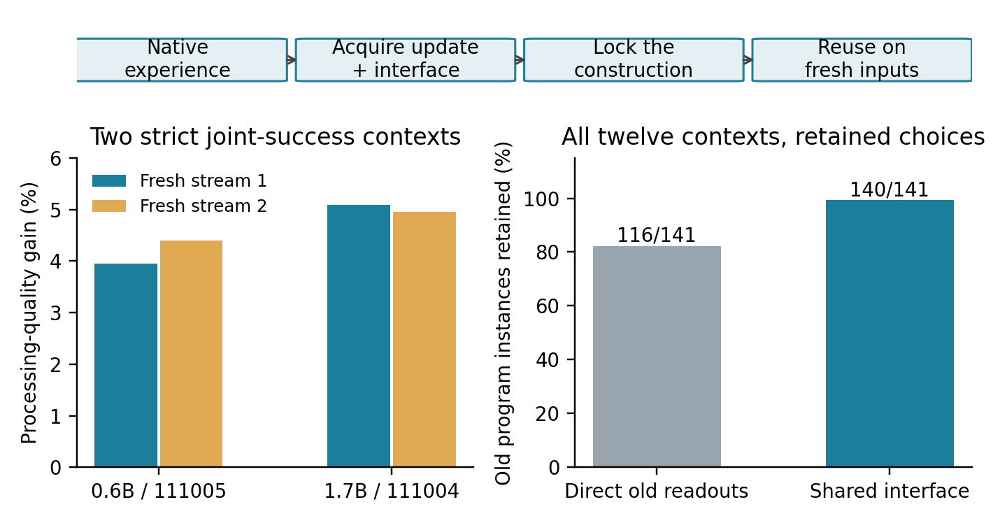
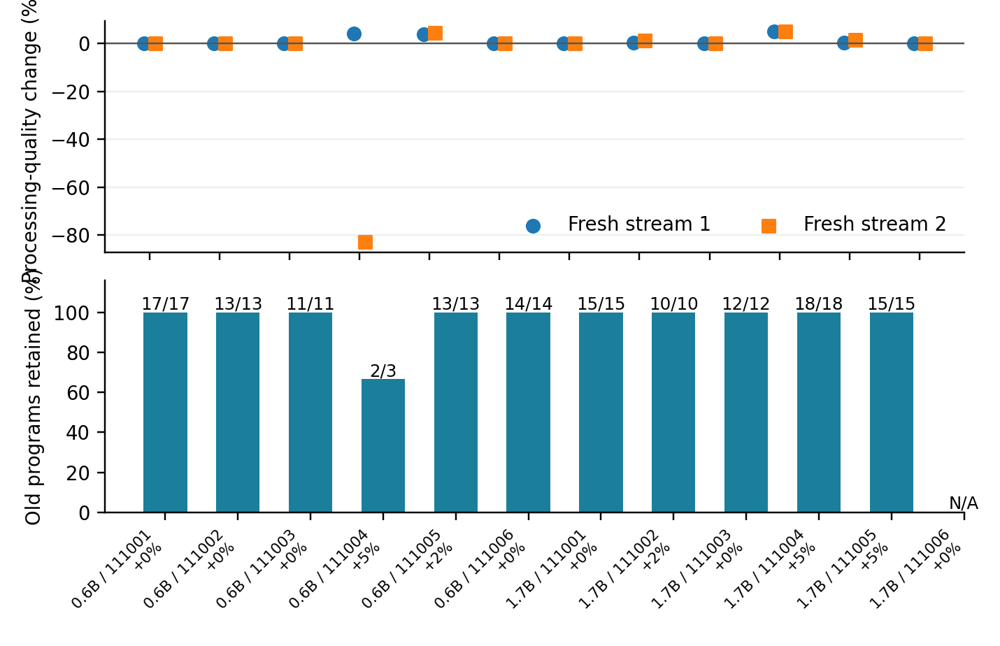

Checkpoint 04: Experience-acquired execution and compatibility reuse
==================================================================

**Paper IV — Nathaniel Oh and Paul Attie — November 13, 2026**

`Paper IV <paper/shaping-gap-benchmark-iv.pdf>`_ ·
`LaTeX source <paper/source/main.tex>`_ ·
`Complete results <results/report/FEEDBACK-RESULTS.txt>`_ ·
`Lifecycle ledger <results/cost-ledger.json>`_ ·
`All checkpoint papers <../../CHECKPOINTS.json>`_

The acquired unit and the result
--------------------------------

Native experience acquires a return update over a complete frozen transformer
body, and paired trajectories acquire a shared observation interface. Execution
feedback selects a pair to retain. The pair, old programs and candidate readouts
are locked before two untouched streams validate reuse.

* **Two strict successes:** 0.6B context 111005 improves the temporal score by
  3.95% and 4.39%, retaining 13/13 old programs versus 9/13 direct; 1.7B context
  111004 improves by 5.09% and 4.96%, retaining 18/18 versus 10/18 direct.
* **All twelve contexts:** five updates retained, seven baseline fallbacks;
  positive pooled mean score changes of +0.114/+0.076; 140/141 old program
  instances retained versus 116/141 direct. One chosen update regresses.
* **Integrity:** 5,040 original-weight native outputs replay bit exactly;
  1,008 score vectors, 387 seals, both policy/transport refits and all choices replay.
* **Costs:** 1,852,268 new native two-position sequences including verification;
  historical acquisition, unused candidates, failures, controls, padding,
  interface/policy/readout storage and process memory are reported separately.

Two studies with separate information boundaries
------------------------------------------------

P61 trains an RBF predictor from 48 historical P59 trials in preserved
Checkpoint 03. The predictor is sealed before twelve new chart/model contexts
are acquired. It uses neural source diagnostics to choose an update before
new functional labels are generated. It selects three updates and one is a
strict joint success, but its pooled quality changes (+0.143/-0.015) miss the
declared aggregate transfer criterion. Retention is 138/141.

P62 treats those P61 outcomes as acquisition feedback in the same contexts.
It retains the candidate with greatest worst-block relative gain, requiring
at least 1% gain in both feedback blocks and full eligible old-program retention,
or keeps baseline. All choices are sealed before seeds 121001/122001 execute.
P61 outcomes are development data here; only the new P62 streams confirm reuse.
No observation map or readout is refitted in P62. This study meets its pooled
learning/reuse criterion. The smaller-model aggregate is mixed across streams;
the complete per-size and per-context results remain public.

The metric is the sum of positive held-out R-squared over 109 nonlinear multi-lag
functions in a 143-function Legendre assay. One-percent joint success also
requires bounded baseline/candidate execution and a nonempty old-program set.
One context has no eligible old program and cannot count as a vacuous success.
All 141 prior-old instances remain reference-reliable in the fresh unchanged
baseline, so unfiltered and fresh-reference retention denominators coincide.
The selected updates add no newly reliable nonlinear target across all four
feedback/validation blocks under the stricter threshold criterion; the random
control has one such target instance. The observed advance is processing quality
with retained computational access.

Model-free independent replay
------------------------------

From this checkpoint directory::

    python3 -m pip install -r requirements-analysis.txt
    python3 code/replay.py
    python3 code/report.py

Replay reconstructs targets independently, applies frozen programs, refits
transport and the predictor, reproduces choices and checks the publication
manifest. Report reconstructs both study analyses from complete recorded scores
and regenerates figures and tables. Outputs go under ``runs/``; recorded data
are preserved. Full trajectories are included as expanded files, each below
GitHub's 100 MiB file limit. No model weights are committed.

Original-weight native verification
------------------------------------

On supported Apple hardware with the native requirements installed::

    python3 -m pip install -r requirements-native.txt
    python3 code/replay.py --native --checkpoint-06 /path/to/Qwen3-0.6B-MLX-4bit --checkpoint-17 /path/to/Qwen3-1.7B-MLX-4bit

The default model locations, when paths are omitted, are the corresponding
folders under this checkpoint's ``models/`` directory. Verification checks
recorded loaded-parameter digests and re-executes saved inputs. The recorded
native environment is Apple M4 Max with 36 GiB, NumPy 2.5.4, MLX 0.32.4 and
MLX-LM 0.32.2. Bit equality is recorded for that configuration; other platforms
should report their numerical tolerances.

Full native acquisition and reuse
----------------------------------

From this checkpoint directory::

    python3 code/prepare_native.py --checkpoint-06 /path/to/Qwen3-0.6B-MLX-4bit --checkpoint-17 /path/to/Qwen3-1.7B-MLX-4bit
    python3 runs/native-workspace/update-policy-study/train.py
    python3 runs/native-workspace/update-policy-study/run.py
    python3 runs/native-workspace/feedback-update-study/run.py
    python3 code/replay.py --data-root runs/native-workspace

If existing model arguments are omitted, preparation downloads the pinned
revisions into ``models/`` (network access required). It copies historical P55
configuration/receipts and the complete historical P59 records from preserved
Checkpoint 03 into a separate workspace, adapting only model receipt paths in
that working copy. The first command refuses to overwrite an already acquired
P61 result directory. Original records stay unchanged.

Fresh chart acquisition regenerates native response geometry and source-selected
baselines. P61 then calibrates additions, acquires source interfaces, seals
choices, fits assessment programs and evaluates two streams. P62 selects from
that feedback, seals its choices and evaluates two further streams without
refitting. Historical acquisition is charged in the ledger; supplied history
is not treated as free experience. Full pretraining costs are inherited.

Artifacts and scope
--------------------

* ``paper/``: Paper IV PDF, complete LaTeX, generated tables and figures.
* ``code/``: portable replay/report/preparation and captured study implementations.
* ``protocols/``: original designs, local registration and the non-vacuous-contract
  clarification. Local timestamps are not external preregistration.
* ``data/results/``: full numeric records, source versions, immutable programs,
  acquired interfaces, choices, failed conditions and native check inputs.
* ``results/``: complete analyses, cost ledger and independent verification.
* ``data/provenance.json``: machine-local receipt path redactions and hashes.
* ``MANIFEST.json`` and ``VERIFICATION.json``: publication integrity and checks.

Current evidence is one experience/acquisition/reuse cycle in known contexts,
with the new-context predictor result reported separately. The next experiment
starts from an accepted updated runtime and tests a second retained gain with
compatibility composition and full maintenance costs. Earlier checkpoints and
papers retain their original files. No arXiv identifier is assigned.
