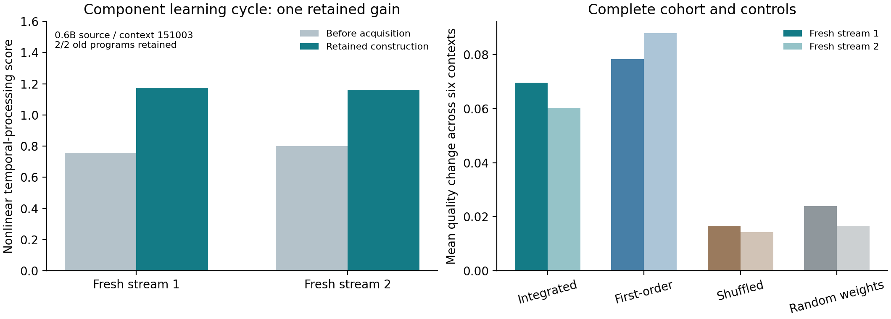

Checkpoint 05: Component learning beyond the transformer graph
==============================================================

**Paper V - Nathaniel Oh and Paul Attie - November 13, 2026**

`Paper V <paper/shaping-gap-benchmark-v.pdf>`_ ·
`LaTeX source <paper/source/main.tex>`_ ·
`Complete results <results/FINDINGS.txt>`_ ·
`Cost ledger <results/cost-ledger.json>`_ ·
`Independent verification <results/independent-verification.json>`_

The advance
-----------

**The acquisition, compatibility, retention and fresh-reuse cycle now runs on
original pretrained neural components without executing the source transformer
graph.**

Twenty-four sampled frozen SwiGLU units provide each context's physical
inventory. Acquired response interfaces predict current effects, partial
sensitivities and finite conditioning effects. The runtime selects four native
fragments, executes their writes, then selects four successors according to
how those writes change their predicted responses. Actual pretrained component
formulas execute on the live state. Attention, original layer order, tokenization
and language generation are outside this runtime.

A response-derived recurrent return update and a shared observation interface
form the acquired pair. Two development streams select a pair or baseline;
all programs, interfaces and choices are locked before two untouched streams.

Measured result
---------------

* In the integrated-guidance 0.6B-derived context 151003, fresh nonlinear
  temporal-processing scores change **0.75648 -> 1.17401** and
  **0.79913 -> 1.16017**. Absolute gains are **+0.41753/+0.36104**.
* The shared interface retains **2/2** eligible old programs, versus **1/2**
  under direct reuse. Relative changes are 55.19%/45.18% from these small
  baselines; absolute scores are the primary readable comparison.
* Across all six pretrained integrated contexts, one update and five baseline
  fallbacks give mean changes **+0.06959/+0.06017**, with **18/18** old program
  instances retained, versus 17/18 direct.
* First-order guidance yields two strict successes; shuffled-conditioning and
  norm-matched Gaussian-weight controls yield one each. Higher-order guidance
  is not uniquely responsible for the successful learning cycle. All 24 cases
  remain in the report.
* Independent replay reproduces **1,440 score vectors**, checks **360 seals**,
  reconstructs every choice, refits every readout/interface, and checks
  **4,800 native component-field outputs** plus 9,600 stage-binding choices.

The score sums positive held-out R-squared over 109 multi-lag nonlinear targets
in a 143-function temporal assay. This is numerical computation, with a supplied
component inventory, grammar and assessment contract. One acquired improvement
is tested; repeated improvement is the next developmental experiment.

Run the complete independent replay
-----------------------------------

From this checkpoint directory::

    python3 -m pip install -r requirements-analysis.txt
    python3 code/replay.py
    python3 code/report.py

Recorded observations stay under ``data/experiment/``. New receipts and reports
go under ``runs/``. Replay and component execution need NumPy; figure reporting
also uses Matplotlib. No model download, hosted service or GPU is required.

Fresh acquisition from the supplied frozen components
-----------------------------------------------------

To execute all 24 study cases, including new source profiles, return acquisition,
compatibility fitting, feedback selection and locked fresh validation::

    OPENBLAS_NUM_THREADS=1 OMP_NUM_THREADS=1 VECLIB_MAXIMUM_THREADS=1 python3 code/run.py
    python3 code/replay.py --data runs/acquisition --output runs/fresh-replay.json
    python3 code/report.py --data runs/acquisition --output runs/fresh-report

The acquisition directory must not already exist. This reproduces the declared
study and seeds; it is a reproducibility check, not a new independent discovery.
The four variants have matched sample counts and construction grammar; each
acquires its own dynamics and baseline.

Optional original-checkpoint extraction
---------------------------------------

Full models are needed only to re-extract and compare the original primitive
responses. On supported Apple hardware, with the pinned local checkpoints::

    python3 -m pip install -r requirements-native.txt
    python3 code/extract.py --model-06 /path/to/qwen3-0.6b-4bit --model-17 /path/to/qwen3-1.7b-4bit

Source model references and exact revisions are in ``data/banks/manifest.json``.
The extractor guards whole-model, transformer-block, attention, embedding and
unembedding calls. It uses original projection/normalization primitives for
fidelity checks and materializes selected frozen rows. All six independently
re-extracted banks reproduce array exactly. Original model parameters are not
trained or edited.

Precision and resource accounting
---------------------------------

Extracted primitive formulas use materialized parameter rows and contracted
coordinates. They preserve the selected native functions with documented
floating-point differences: maximum relative discrepancy against original
mixed-precision module probes is 1.91%. Independent full-coordinate replay of
the compiled runtime has maximum relative output error 1.20e-6. These are two
separate comparisons; this checkpoint does not claim original-module bit equality.

The recorded numerical experiment takes 41.32 seconds with 94.23 MiB whole-process
peak RSS, after preparation. Conservative saved pretrained runtime arrays occupy
994,912 or 1,740,384 bytes per context; selected return and shared observation
interface use another 1,536 and 5,376 bytes. This is a small extracted-component
computation, rather than the complete language model in that footprint.

The ledger records all unused returns, candidate streams, interface predictions,
fragment executions, derivative labels, fits, controller arrays, readout programs
and verification. Full-matrix preparation and original-module checks are charged
separately. Complete initial extraction wall time and preparation peak memory
were not recorded; the independent complete extraction and portable release
validation are separately timed. No full-pipeline saving or electrical energy
measurement is inferred from the runtime figures.

Artifact map
------------

* ``paper/``: final PDF, LaTeX, generated tables and figures.
* ``code/``: portable execution, replay, reporting and optional extraction.
* ``protocols/``: original local prospective protocol and portable metadata version.
* ``data/banks/``: extracted parameter banks, model attribution and fidelity.
* ``data/experiment/``: every source, feedback and fresh trace, acquired profile,
  return, compatibility map, unchanged readout, seal and captured executed source.
* ``data/provenance.json``: metadata path redactions and wrapper transformations.
* ``results/``: full results, costs, independent replay and derivative checks.
* ``MANIFEST.json`` and ``VERIFICATION.json``: publication integrity and release QA.

Building forward
----------------

The next threshold starts from the accepted component runtime and acquires
another improvement while retaining the first. The present active response span
can have no useful measured complement; recruiting additional physical ports
from unmet requirements is a concrete target for the next acquisition cycle.

Earlier checkpoint papers and data retain their original paths. Paper V is a
repository publication; an arXiv identifier will be added when assigned.
Extracted and transformed Qwen arrays retain the model terms and attribution
in the root ``THIRD_PARTY_NOTICES.rst`` and ``third-party/QWEN-LICENSE``.
