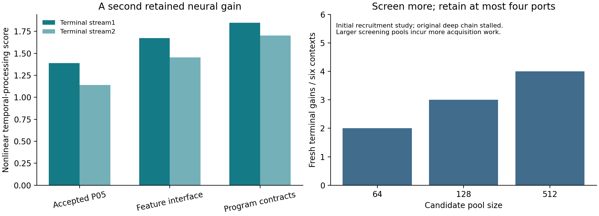

Checkpoint 06: A Second Compatible Neural Acquisition
=====================================================

**An already improved runtime acquires another pretrained neural component,
keeps its earlier programs usable, and validates the retained construction on
new inputs.** The learned shared interface is fitted to program requirements.

`Paper VI <paper/shaping-gap-benchmark-vi.pdf>`_ · `Complete findings <results/FINDINGS.txt>`_
· `Machine-readable results <results/analysis.json>`_ · `Cost ledger <results/cost-ledger.json>`_

Measured advance
----------------

Starting from the accepted Checkpoint 05 runtime, the program-contract arm
changes two untouched terminal temporal-processing scores from **1.38792/1.13904
to 1.84921/1.70404** (33.24%/49.60%), with **6/6** protected program instances
retained across three frozen libraries. These are repeated program instances,
not six distinct newly acquired functions. The feature-map control improves
20.52%/27.61%; the interface-only arm retains baseline. Both successful arms
acquire one physical port in their third round. Each arm runs five rounds;
one additional acquisition is accepted, so the stronger two-additional-gain
criterion is false.

The original pretrained parameters stay fixed. The retained construction adds
one native port to the 24-component runtime, keeps one 600-value observation map,
and retains 1,102,272 bytes of conservatively counted runtime/program arrays.
The controller executes numerical functions without the original transformer
graph. This score is a finite nonlinear temporal-processing measure, rather
than language-answer accuracy. The new shared map uses numerical source targets
through unchanged program readouts; its acquisition is supervised.

What changed and why
--------------------

P64 first tests guided recruitment from 64/128/512 candidate ports, random-128
and resident-bank controls across six inherited contexts. Larger guided pools
yield 2/3/4 fresh terminal successes, with increasing acquisition work. Random
and resident controls each yield three. The already improved deep chain gains
nothing in this study: candidate improvements often damage earlier processing
quality. These full negative outcomes remain in the artifact.

P65 prospectively changes the interface objective on new source/feedback/fresh
streams. Instead of treating every observation coordinate equally, it fits one
shared affine map to the frozen programs' numerical functional contracts, with
feature anchors and regularization. Feedback selects the execution/interface
pair; fresh tests commit or roll back; untouched terminal streams assess the
final retained state. All previous reliability and quality guards remain.

P66: the application boundary is measured
-----------------------------------------

A chronological test on the public UCI Appliances Energy Prediction series
freezes those controllers and fits forecast readouts. One-hour test RMSE changes
**83.1373 to 82.6682 Wh** (0.564% lower; paired daily-block interval 0.101-1.175%).
Ten-minute error rises **2.220%**, four-hour improvement is approximately 0.009%,
and the 64-lag ridge autoregression reference is stronger at all three horizons.
The prospectively required >=1% one-hour improvement with <=1% regression
elsewhere is **not met**. All eight controllers/references and every forecast
are released. This supplies concrete application contracts for the next
acquisition, including the short-horizon regression to protect.

The study is univariate forecasting on one house, not a full multivariate
benchmark or a measured commercial/energy saving. Attribution and unmodified
source data are under ``data/application/`` (CC BY 4.0).

Replay the complete evidence
----------------------------

From the repository root::

    python3 -m pip install -r checkpoints/06-cumulative-contract-interfaces/requirements-analysis.txt
    python3 checkpoints/06-cumulative-contract-interfaces/code/replay.py

The supplied frozen component banks run on CPU. No full model download, hosted
service or language prompting is needed. Replay independently refits source
heads and checks all feedback choices, acceptances, rollbacks, terminal gains,
600-value map shapes and retained slot caps. It verifies **12,112** temporal
score vectors, **1,109** seals, **300** program-map stationarity conditions,
**8,320** full-coordinate native response/partial points and all **48** application
metric rows. New receipts go to ``runs/replay/``; recorded data remain read-only.

Acquire fresh constructions
---------------------------

The launcher copies the numerical source into a fresh workspace, references the
preserved Checkpoint 05 artifact and immutable recruitment pool, then runs the
captured protocol::

    python3 checkpoints/06-cumulative-contract-interfaces/code/acquire.py contract
    python3 checkpoints/06-cumulative-contract-interfaces/code/acquire.py application
    python3 checkpoints/06-cumulative-contract-interfaces/code/acquire.py recruitment

Default workspace: ``runs/workspace/``. Each result directory must be absent
before starting that study; use ``--workspace PATH`` for another fresh run.
Set numerical BLAS thread counts to one for closest timing/reproduction.
Publication replay and the fresh contract/application rerun receipts are in
``results/verification/``. Preparation does not load full source models.

Optional re-extraction requires the exact model revisions recorded in
Checkpoint 05, their local paths, Apple Silicon/Metal and the native requirements::

    python3 checkpoints/06-cumulative-contract-interfaces/code/extract.py --model-06 PATH --model-17 PATH

Pool extraction is source-guarded and reports original mixed-precision fidelity
separately from compiled full-coordinate arithmetic. Numerical materialization
is not a claim of bit-identical original-module execution.

Artifact layout and accounting
-------------------------------

- ``code/source/``: captured numerical acquisition implementations and protocols.
- ``code/verification/``: independent numerical checks with portable path/output changes.
- ``data/experiments/``: complete candidates, native traces, scores, sealed heads,
  maps, choices, rollbacks, terminal tests, original source snapshots and failure.
- ``data/pools/``: 512 additional frozen ports per context in 16-row chunks.
- ``data/application/``: unmodified public source data, hashes and attribution.
- ``protocols/``: prospective study configurations; ``paper/source/``: LaTeX and figures.
- ``results/``: full analyses, figures, lifecycle ledger and verification receipts.

P64/P65/P66 numerical execution takes 175.41/48.79/5.27 seconds in the original
recorded environment, with peak RSS 88.92/150.73/159.45 MiB. Pool preparation
is 6.38 seconds with 1.47 GiB peak process RSS. Those are whole-study measurements,
not production request latency. The immutable substrate archive is separate
from bounded retained state. Discovery, unused candidates, map fitting, failed
selections, rollbacks, program libraries and terminal tests are recorded.
Historical costs and missing initial-preparation timing remain explicit.
Electrical energy and customer savings are unmeasured.

The initial P64 launch stopped before feedback at an exact-equality assertion
with only 4.24e-16 feature discrepancy and identical states. The preserved retry
uses the inherited numerical tolerance without changing scientific criteria.
Complete failed-process duration was not captured. P65 progress contains an
inherited expected-count display of 18; protocol and summary correctly specify
three arms. The P66 ``runs.jsonl`` is explicitly marked as a retrospective
catalogue sidecar pointing to the immutable original summary, not a runtime log.

Next threshold
--------------

Acquire directly against the application's forecast contracts, protecting the
short horizon while improving the longer horizon against AR64. Continue beyond
this second neural gain, then exercise replacement in a full active bank.
The current construction retains one port; four-port eviction and higher-order
selection necessity have not yet been exercised. These are concrete next studies.

Nathaniel Oh and Paul Attie · November 13, 2026.
